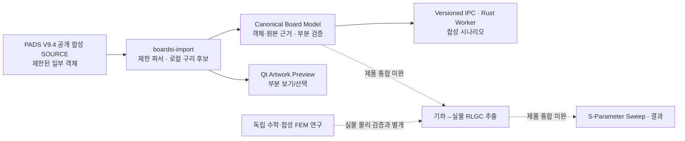

# BoardSI 문서 허브 | Documentation hub

> **프로젝트 상태 기준: 2026-11-07 KST.** BoardSI는 **제한된 Native Qt/Rust Developer Preview**입니다. 공개 합성 PADS V9.4 MILS 일부 객체를 표시·검증할 수 있지만, 범용 CAD Import·전역 전기적 연결성·실제 PCB의 RLGC/S-Parameter 분석이 완료된 제품은 아닙니다. 최신 상태는 아래 **단일 체크리스트**를 우선합니다.

[← 프로젝트 README](../README.md) · [처음 실행하기](developer-quickstart.md) · [현재 구현 범위](development-checklist.md) · [개발 참여](../CONTRIBUTING.md)

**문서 현황 검증(2026-11-08 KST):** Markdown **189개** 중 검증 원장 158개는 [전체 색인](validation/INDEX.md)에 있고, 나머지 안내·설계·운영 파일은 이 허브와 분야별 README에서 관리합니다. 최근 [문서 정리 PR #512/#515 및 CI 최적화 PR #516/#517의 정식 근거](development-checklist.md#documentation-ci-evidence)는 **단일 체크리스트에 별도로 기록**했습니다. 문서 개수는 제품 개발 완료율이 아닙니다.

## 처음 방문했다면 — 읽기 순서

| 순서 | 문서 | 무엇을 확인하나 |
| :--- | :--- | :--- |
| 1 | **[프로젝트 개요](../README.md)** | 무엇을 만들며 무엇을 아직 못 하는가 |
| 2 | **[개발자 Quickstart](developer-quickstart.md)** | 공개 합성 파일로 Rust·Importer·Qt Preview 빌드/실행 |
| 3 | **[단일 개발 체크리스트](development-checklist.md)** | 기능 단위 최초 체크일, 증거, 미검증 범위; 제품 진행률과 다름 |
| 4 | **[v1.0 개발 사양서](specification/BoardSI_Development_Spec_v1.0.md)** | **요구사항 기준선** U01–U48 / 인수시험 정의 T01–T54; 구현 결과 아님 |
| 5 | **[아키텍처](architecture/README.md)** | Rust, Canonical Model, PADS Importer, Qt/Worker IPC, 연구용 FEM의 경계 |
| 6 | **[검증 허브](validation/README.md)** | 각 단계의 테스트/승인 증거와 실패·미완 상태 |
| 7 | **[Preview 배송·운영 정책](preview-delivery-playbook.md)** | 기능 우선순위, 프로토타입과 배포판의 구분 |

## 문서 종류별 길찾기

| 문서 성격 | 출발점 | 관리 원칙 |
| :--- | :--- | :--- |
| **제품 요구사항 (normative)** | [v1.0 명세](specification/BoardSI_Development_Spec_v1.0.md) | 사용자 승인 기준선; 문서 정리만으로 요구조건 변경 금지 |
| **구현 상태 (living ledger)** | [개발 체크리스트](development-checklist.md) | **유일한 정식 체크리스트**. 날짜·원본·PR/커밋·실제 CI 근거 확인 |
| **실행 및 사용** | [Quickstart](developer-quickstart.md), [Qt 앱 안내](../apps/boardsi-qt-prototype/README.md), [PADS Importer 안내](../crates/boardsi-import/README.md) | 지원되는 입력/OS/명령만 설명 |
| **설계/계약** | [아키텍처 목차](architecture/README.md), [수치 계약](architecture/numerical-contract.md), [Canonical Model](architecture/canonical-board-model.md) | 구현된 제한 API와 제안/미구현 분리 |
| **실행 증거·안전 판정** | [검증 목차](validation/README.md) | PR *해당 SHA*의 CI, 독립 Oracle, FAIL/NOT_VERIFIED 구별 |
| **개발 운영** | [프로젝트 관리](project-management.md), [공헌 가이드](../CONTRIBUTING.md), [계획 JSON](project-plan.json) | PR 보호, 문서-only CI, 개인정보·CAD 보안 정책 |
| **날짜가 고정된 기록** | [2026-10-18 전체 감사](audits/2026-10-18-pre-ph08-project-audit.md), [개발 이력](development-history.md) | 작성 시점의 **역사적 증거**. 최신 상태로 오인하지 않도록 날짜 표시 |
| **디자인** | [브랜드 아이콘 B 결정](branding/boardsi-icon-decision.md) | 승인된 SVG는 임의 재생성·교체 금지 |
| **문서 품질** | [2026-11-07 문서 감사·수정 기록](audits/2026-11-07-documentation-audit.md) | 검토 범위·교정된 오류·미실시 검증을 투명하게 기록 |

## 세부 자료 빠른 링크

- **[전체 검증 보고서 158개 색인](validation/INDEX.md)** — Stage A/B/C/D, M0/M2/PH-08과 보안 증거를 구분해 원문으로 이동합니다.
- **[Trace–Via–SMD Pad의 범용 구리 접촉 설계 계약](architecture/trace-copper-contact.md)** — 비중심 Via·Pad 모서리·원호와 드릴 구멍의 판정 수학, Net/Layer·Fail-Closed 경계를 설명합니다.
- **[문서 작성 및 검증 표준](documentation-standards.md)** — 증거 SHA, 검증 상태 용어, 역사적 기록 보호 및 문서 전용 CI 규칙입니다.

## 실제 구현과 제품 목표를 혼동하지 않기

| 영역 | 확인된 제한 기능 | 아직 제품 인수되지 않은 것 |
| :--- | :--- | :--- |
| PADS V9.4 MILS | 공개 합성 SOURCE의 일부 직선/원호, Via, SMD Pad, Copper·참조 도형 Import 및 2D Qt Artwork Preview | 모든 PADS 리비전/Padstack, ODB++, 실수출 데이터 전체 호환성 |
| Trace 연결 기하 | [D_054/D_055](validation/d054-d055-general-trace-contact-qualification.md): 임의 각도의 유한 선폭 Trace·원호 및 Via 환형 도체/부품 SMD Pad의 **국소 겹침 후보** | 전체 PCB 전기적 Open/Short 판정, 모든 도형·도금·Thermal·Pour, 신규 후보의 Qt 전역 그래프 통합 |
| Canonical / Worker / Qt | Rust 타입/원본 근거, 독립 Worker·버전별 IPC, Native GUI 제한 검증 | 실제 End-to-End 포트·Solver·Touchstone 제품 흐름 |
| SI 수치 | **외부에서 주어진** scalar RLGC → uniform 2-port S의 수학 검증; 제한된 PEC/lossless FEM 합성 쿠폰 | 보드 기하→주파수 의존 RLGC 물리 추출, 30 GHz 제품 정확도 |
| PH-08 | 역사적 원본 Gate Q 재현 | **FAIL 유지**, 물리적 승인·Rust FEM 진행 승인 없음 |
| 배포 | 소스 빌드·개발자 Preview 실행 근거 | 라이선스 확인을 마친 최종 설치/상용 배포 |

각 행의 **PASS**는 그 시험에 명시된 범위의 PASS입니다. **전기적 정확성, 제품 완성률, 실제 보드 승인으로 확대 해석하면 안 됩니다.** Stage A/B/C/D 체크 수와 제품 U/T 인수 개수는 서로 다른 척도입니다.

## 개발 경로와 구현 상태

실선은 **지원되는 제한 경로의 구조 개념**이고, 점선은 **아직 제품으로 이어지지 않은 개발 경계**입니다. 이 도식 자체는 모든 입력 형식의 완전한 E2E 작동을 보증하지 않습니다.

## 근거를 읽는 방법

- **Confirmed / 검증된 사실:** 파일·커밋·PR-head SHA, Native 실행 로그, 독립 수치 기준이 명시된 *한정 결과*.
- **Partial / 한정 구현:** 지원 가능한 원본 객체·기능이 일부이며, 제외 입력을 지원한다고 가정하면 안 되는 상태.
- **Proposed / 계획:** 설계 또는 목표만 존재. 컴파일이나 CI 녹색으로 구현 완료 처리하지 않음.
- **Blocked / Fail / Not Verified / Not Run:** 각각 원인·검증 실패·증거 미확보·시험 미실시. **같은 의미가 아닙니다.**
- 원본 PH-08 Gate Q **FAIL**과 M0 종료 **BLOCKED**는 합성 시험 PASS나 문서 수정으로 변경되지 않습니다.

## 보안·라이선스 경계

실제 회사 PCB/Net/Stackup/Touchstone, 사내 경로와 인증정보는 공개 GitHub, Issues, PR, Actions, 생성형 서비스에 올리지 마세요. 샘플은 공개 재배포가 허용된 데이터 또는 합성 원본만 사용합니다. [보안 정책](../SECURITY.md). 소스 저장소의 공개 여부는 재사용·상업 배포 라이선스 승인을 의미하지 않습니다.

**오류를 발견했다면:** 날짜가 고정된 검증 원장을 임의로 덮어쓰기보다, 새 근거·정정 대상·영향·상태를 명시한 문서 PR을 만드세요. 소스 코드 변경과 문서 수정은 검증 범위를 구분하며, [공헌 정책](../CONTRIBUTING.md)의 docs-only CI 규칙을 따릅니다.
