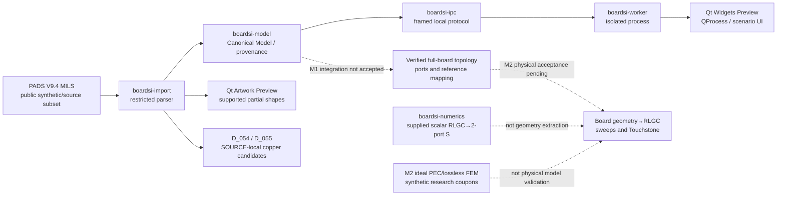

# BoardSI architecture — implementation map and contract boundaries

[← Documentation hub](../README.md) · [Developer Quickstart](../developer-quickstart.md) · [v1.0 specification](../specification/BoardSI_Development_Spec_v1.0.md) · [Canonical implementation tracker](../development-checklist.md)

> **Scope checkpoint: 2026-11-09 KST.** This is an overview of **implemented partial prototypes and open engineering gates**, not a new normative architecture decision, an end-to-end PCB solver approval, or a rewrite of frozen mathematical/physical contracts.

## System view: present implementation vs intended product flow

**Read the arrows carefully:** solid connections identify *existing code paths/components*, not a fully accepted product workflow. Dashed connections are **missing or independently unqualified integration**. The local Rust geometry candidates do **not** automatically become a verified electrical connectivity graph or Qt visualized result.

### D_056 — Generic input and stackup-aware Via topology (foundation, not full CAD import)

[D_056 input normalization / implementation history](input-normalization.md) covers merged #521/#523/#526 and separate layer-aware diagnostic Qt #528. The [D_056_01 inspected-source audit and universal evidence contract](d056-01-source-evidence-audit.md) maps the actual parser/model/graph/viewer limitations to D_056_02–12. The [D_056_02 source-layer copper candidate graph](d056-02-source-layer-graph.md), merged in [#535](https://github.com/july-rust/BoardSI/pull/535), reuses geometry kernels and records unverified barrel spans without creating certified electrical graph edges. Restricted PADS V9.4 source-declared Through/Blind/Buried R/S/A/RA/SA geometry exists in an **opt-in** path, but manufactured plating/microvia classification, native format completeness, universal replacement of legacy V1–V14 consumers, global electrical connectivity and physical SI remain unverified. A separate opt-in Canonical path has been added to the **actual main Qt Viewer** in D_056_05; it does not claim that every old V1–V14 consumer handles arbitrary shaped partial vias. [D_056 tracker](../development-checklist.md#d_056) remains OPEN.

**D_056_04 source-bound Canonical IPC:** [versioned Padstack/Via transport design and native verification](d056-04-canonical-padstack-ipc.md) records accepted code PR #549, exact source/geometry IDs, bounded Qt decoder and independently tested multilayer Rust→Qt bridge. It is opt-in, separate from legacy Qt Artwork V1–V14. **D_056_05 main Qt integration:** [native CPU/RHI artwork and lifecycle contract](d056-05-qt-main-artwork.md) · [code PR #551](https://github.com/july-rust/BoardSI/pull/551) → protected Verified squash [main `6103a1b`](https://github.com/july-rust/BoardSI/commit/6103a1b6d6f1068b548f4cbb13d7c9cfff6544dd). Source-derived per-layer Via/Pad/Drill/AntiPad display, Picking/Hover and cancellation preserve the independent V1–V14 legacy path. The wider native PADS/other-CAD, manufactured copper continuity, complete electrical Open/Short and SI remain OPEN.

**D_056_06 PADS RT/ST SOURCE Thermal:** [근거·Canonical V2 IPC·Qt CPU/RHI 안전 전환 및 회귀 검증](d056-06-thermal-source.md) · [코드 PR #553](https://github.com/july-rust/BoardSI/pull/553) · [main 코드 Squash `e034335b`](https://github.com/july-rust/BoardSI/commit/e034335b055f068edcd68a17676c1f8f3e161fd8). 실제 Thermal Spoke Copper와 Relief Void를 구별하고 Qt 메인 Artwork에서 CPU 형상을 보존합니다. Native Rust/Qt 4개 플랫폼과 12/12 PR 워크플로 PASS. Source-scope local contact *후보*만 검증했으며 실제 제조 Plane/CAM, Barrel/Plating 도통, 전역 Open/Short와 SI는 **NOT_VERIFIED**입니다. 상위 #530은 D_056_07 제조 구조 작업으로 계속 OPEN입니다.

**D_056_08 ODB++ SOURCE 제한 구현:** [Source Adapter 상세 검증 범위·미지원 및 CI 증거](d056-08-odb-source-adapter.md) · [Matrix/LPA 코드 PR #562](https://github.com/july-rust/BoardSI/pull/562) (30/30 Checks, Verified Squash [`1f33e75`](https://github.com/july-rust/BoardSI/commit/1f33e75beced7115cb65453aca4c6e9fc1d6df36), main Push 8/8) · [양성 Surface/Contour 코드 PR #564](https://github.com/july-rust/BoardSI/pull/564) (30/30 Checks, Verified Squash [`0d832dd`](https://github.com/july-rust/BoardSI/commit/0d832dd92d86ea1d6e375b89506cf74be9b252d0), 독립 main Push 8/8). 압축 해제된 ODB++Design Source의 Matrix/Step, 제한된 L/P/A, 단일 Positive S Copper Island와 직선 경계 Cutout을 출처 SHA·File/Line과 함께 Canonical Trace/Pad/Arc/Area/Cutout으로 변환하는 Rust Reader·진단 CLI를 구현했다. 외부 벤더 Export/Oracle, 전체 S/OC/복수 Island, 압축 ODB 패키지, **전체** EDA/Net/Component/Via/Drill/Plating, Main Qt Import/IPC 및 전기 Graph/실제 제조/SI는 **NOT_VERIFIED**. 또한 [EDA 설계 Net 소유 관계 코드 PR #566](https://github.com/july-rust/BoardSI/pull/566) (30/30 Checks, Verified Squash [`ffdad981`](https://github.com/july-rust/BoardSI/commit/ffdad981aa96a2a89eee9c8f569b3d7b74916f58), 독립 main Push 8/8 SUCCESS)는 명시적인 `--eda-nets` 선택 시 한정된 NET/SNT/FID를 정확한 Source 행번호와 연결하며 기존 Geometry-only SourceIdentity를 유지한다. 이 정보는 설계 Net 소유 관계일 뿐 Via 도금이나 전기적 연결 증명이 아니다. D_056_08 전체 기능 인수는 완료되지 않았고 #520과 #532는 OPEN이다. 2026-11-10 후속 [코드 PR #568](https://github.com/july-rust/BoardSI/pull/568)은 ODB++ MATRIX의 명시적 Drill Layer Span과 layer/tools의 TYPE/TYPE2/NUM/Size를 SOURCE 증거로 감시한다(30/30 PR Checks, 보호 Squash `badc4fb`, 독립 Main Push 8/8). 이후 [코드 PR #569](https://github.com/july-rust/BoardSI/pull/569) (30/30 PR Checks, Verified Squash `f07442a1`)은 독립 ODB++ Drill P Feature의 위치·Tool NUM 교차 검증 및 Source File/Line/SHA를 추가했다. 하지만 **Canonical Drill/Via·실제 Plating·Qt IPC·전기 Graph·SI와 외부 벤더 검증은 여전히 미완이며** 전체 D_056_08도 아직 미완이다.

### 범용 Trace 접촉의 공통 설계 근거

[D_054/D_055 Copper 접촉 계약](trace-copper-contact.md)은 임의 방향 직선·원호 Trace의 유한 선폭과 비중심 Via 환형 패드, 원형·정사각형·직사각형 SMD Pad 전체 영역 사이의 SOURCE-local 접촉 후보를 정리합니다. 이는 **전체 PCB Open/Short, 글로벌 연결 그래프, 물리 SI 검증**의 완료가 아닙니다. 검증 보고서는 [D_054/D_055 기록](../validation/d054-d055-general-trace-contact-qualification.md)을 확인하십시오.

## Repository packages and responsibility

| Layer | Implemented boundary | Current caveat / evidence |
| :--- | :--- | :--- |
| `crates/boardsi-import` | PADS signature probe; subset parser and canonical/artwork output; selected pads/vias/copper/arc/source-provenance; SOURCE-local finite-width contact candidates | [Importer README](../../crates/boardsi-import/README.md); incomplete full exporter/Padstack/Net connectivity support |
| `crates/boardsi-model` | Typed identities, geometry, frames, materials, diagnostics and evidence-bearing connectivity structures | [Canonical Model contract](canonical-board-model.md); structural correctness alone is not physical correctness |
| `crates/boardsi-ipc` | Bounded versioned local Rust/Qt Worker transport | [IPC/Qt design](worker-ipc-qt-prototype.md); source paths and net confidentiality are separate security concerns |
| `apps/boardsi-worker` | Isolated synthetic progress/model handoff | [M0 handoff](m0-model-gated-worker-handoff.md); **not** real geometry-derived SI |
| `apps/boardsi-qt-prototype` | Qt Widgets/QProcess, partial Artwork/Explorer and optional graphics backends | [Qt build & developer Preview](../../apps/boardsi-qt-prototype/README.md); GPU requested ≠ GPU verified |
| `crates/boardsi-numerics` | Given scalar R/L/G/C and length/frequency → complex uniform two-port math | [Numerical contract](numerical-contract.md); does not calculate physical R/L/G/C from imported geometry |
| `docs/architecture/m2-rlgc-physical-model-adr.md` | Proposed physics extraction stages, coupled conductors, loss and 30 GHz gating | [ADR](m2-rlgc-physical-model-adr.md) is **proposed**, not product-certified implementation |

**Input independence:** import adapters must normalize their own formats to the **same Canonical Board Model**. ODB++Design, PADS ASC, IPC-2581, Gerber and KiCad are **inputs/roadmap targets**, not interchangeable native storage or evidence of already complete importers.

## Copper connectivity: what the new geometry layer really proves

D_054 and D_055 remove **angle-specific, via-centre-only and pad-centre-only** predicates for supported SOURCE objects.

- Generic **straight and directed circular-arc** Trace centreline distances are combined with finite conductor widths.
- Via contact evaluates the **outer pad disk minus drilled hole (conductive annulus)** and checks that the relevant layer actually has a pad. Passing through a drill aperture **is not a copper contact**.
- Component SMD pads use **whole round, square or rectangle footprints**, including edges, corners and non-centred/Trace-midspan hits.
- Ambiguous near-tangency and unsupported records are **fail-closed**, not silent PASS. Different-net intersections are tagged as conflict *candidates*, not automatic real-world shorts.
- Source SHA, supported PADS grammar and provenance determine what can be trusted. Restricted public synthetic examples are validated; physical copper plating, thermal connections, full CAD nets and measured PCB correlates remain **NOT_VERIFIED**.

[Source-local qualification and CLI](../validation/d054-d055-general-trace-contact-qualification.md). **Still open:** integrate candidate evidence into the actual Canonical full-board connectivity graph and Qt UI, then verify a legitimate Import→Port→Solver path separately. Avoid creating a new phase for each possible angle/side/corner. This is a single algorithm with parameterized/property-based tests.

## Decisions, non-decisions and program status

| Topic | Decision/evidence | Open product gate |
| :--- | :--- | :--- |
| Desktop UI | Existing **Qt Widgets + QProcess** prototype, optional OpenGL/Qt Quick-RHI artwork backends | Final UX, performance on actual dense boards and Qt redistribution/licensing |
| IPC | Isolated Rust Worker, versioned bounded frames, synthetic model handoff | Actual solver jobs and full-board provenance/stale/cancel contracts |
| Model | Format-neutral Canonical Board Model | Validated full import/solver fidelity on real source exports |
| Physics | Restricted M0 scalar mathematical API, M2 synthetic PEC/lossless PH-03/05/06/07 evidence | Real frequency-dependent loss, multiconductor, coupling, vias/discontinuities, measured 30 GHz |
| PH-08 | Original Stage 4 + authorized private Stage 5B HMM Gate Q historical **FAIL** reproduced | AC-P1 PENDING, T/R PROPOSED_NOT_FROZEN, PH-08 contract NOT_FROZEN, Rust FEM NO_GO, physical BOUND_NOT_CERTIFIED |
| M0 | Narrow native prototype gates and source-only runnable Preview | [M0 completion gate](../validation/m0-completion-gate.md) remains **BLOCKED** |

**Historical Qt latency note:** former 1,000 ms event-loop checks had specific failures on macOS ARM64 and Windows ARM64. Owner's **2026-10-20 provisional M0 F8 limit is 1,500 ms**; the old failure was not erased and its root cause is not proved resolved by a rerun. [Historical vs current acceptance policy](../validation/m0-f8-provisional-1500ms-policy.md); [issue #46](https://github.com/july-rust/BoardSI/issues/46).

## Read the contracts and evidence in this order

1. [Specification v1.0](../specification/BoardSI_Development_Spec_v1.0.md) — product requirements; change only through explicit versioned requirements control.
2. [Canonical Model contract](canonical-board-model.md) and [Worker/IPC](worker-ipc-qt-prototype.md) — data ownership, provenance, validation/transport.
3. [Numerical contract](numerical-contract.md) — exact reference impedance, sign/unit and scalar 2-port conventions.
4. [M2 physical RLGC ADR](m2-rlgc-physical-model-adr.md) and [independent verification plan](../validation/m2-rlgc-independent-verification-plan.md) — **proposals and required reference methods**, not a sign-off.
5. [Executed scoped M0/M1/M2 evidence index](../validation/README.md), [current checklist](../development-checklist.md) — real status and exceptions.
6. [Whole-project historical audit, 2026-10-18](../audits/2026-10-18-pre-ph08-project-audit.md) — a **date-pinned snapshot**, not a current inventory.

**Never promote:** syntax/structural PASS → geometry/Net correctness; geometry candidate → manufactured electrical Open/Short; scalar numerical PASS → 2D/3D physics accuracy; synthetic PH PASS → PH-08 approval; or CI success → release eligibility.
