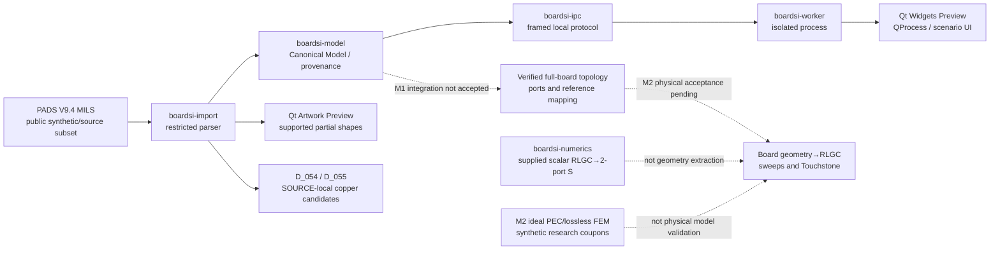

# BoardSI architecture — implementation map and contract boundaries

[← Documentation hub](../README.md) · [Developer Quickstart](../developer-quickstart.md) · [v1.0 specification](../specification/BoardSI_Development_Spec_v1.0.md) · [Canonical implementation tracker](../development-checklist.md)

> **Scope checkpoint: 2026-11-07 KST.** This is an overview of **implemented partial prototypes and open engineering gates**, not a new normative architecture decision, an end-to-end PCB solver approval, or a rewrite of frozen mathematical/physical contracts.

## System view: present implementation vs intended product flow

**Read the arrows carefully:** solid connections identify *existing code paths/components*, not a fully accepted product workflow. Dashed connections are **missing or independently unqualified integration**. The local Rust geometry candidates do **not** automatically become a verified electrical connectivity graph or Qt visualized result.

### 범용 Trace 접촉의 공통 설계 근거

[D_054/D_055 Copper 접촉 계약](trace-copper-contact.md)은 임의 방향 직선·원호 Trace의 유한 선폭과 비중심 Via 환형 패드, 원형·정사각형·직사각형 SMD Pad 전체 영역 사이의 SOURCE-local 접촉 후보를 정리합니다. 이는 **전체 PCB Open/Short, 글로벌 연결 그래프, 물리 SI 검증**의 완료가 아닙니다. 검증 보고서는 [D_054/D_055 기록](../validation/d054-d055-general-trace-contact-qualification.md)을 확인하십시오.

## Repository packages and responsibility

| Layer | Implemented boundary | Current caveat / evidence |
| :--- | :--- | :--- |
| `crates/boardsi-import` | PADS signature probe; subset parser and canonical/artwork output; selected pads/vias/copper/arc/source-provenance; SOURCE-local finite-width contact candidates | [Importer README](../../crates/boardsi-import/README.md); incomplete full exporter/Padstack/Net connectivity support |
| `crates/boardsi-model` | Typed identities, geometry, frames, materials, diagnostics and evidence-bearing connectivity structures | [Canonical Model contract](canonical-board-model.md); structural correctness alone is not physical correctness |
| `crates/boardsi-ipc` | Bounded versioned local Rust/Qt Worker transport | [IPC/Qt design](worker-ipc-qt-prototype.md); source paths and net confidentiality are separate security concerns |
| `apps/boardsi-worker` | Isolated synthetic progress/model handoff | [M0 handoff](m0-model-gated-worker-handoff.md); **not** real geometry-derived SI |
| `apps/boardsi-qt-prototype` | Qt Widgets/QProcess, partial Artwork/Explorer and optional graphics backends | [Qt build & developer Preview](../../apps/boardsi-qt-prototype/README.md); GPU requested ≠ GPU verified |
| `crates/boardsi-numerics` | Given scalar R/L/G/C and length/frequency → complex uniform two-port math | [Numerical contract](numerical-contract.md); does not calculate physical R/L/G/C from imported geometry |
| `docs/architecture/m2-rlgc-physical-model-adr.md` | Proposed physics extraction stages, coupled conductors, loss and 30 GHz gating | [ADR](m2-rlgc-physical-model-adr.md) is **proposed**, not product-certified implementation |

**Input independence:** import adapters must normalize their own formats to the **same Canonical Board Model**. ODB++Design, PADS ASC, IPC-2581, Gerber and KiCad are **inputs/roadmap targets**, not interchangeable native storage or evidence of already complete importers.

## Copper connectivity: what the new geometry layer really proves

D_054 and D_055 remove **angle-specific, via-centre-only and pad-centre-only** predicates for supported SOURCE objects.

- Generic **straight and directed circular-arc** Trace centreline distances are combined with finite conductor widths.
- Via contact evaluates the **outer pad disk minus drilled hole (conductive annulus)** and checks that the relevant layer actually has a pad. Passing through a drill aperture **is not a copper contact**.
- Component SMD pads use **whole round, square or rectangle footprints**, including edges, corners and non-centred/Trace-midspan hits.
- Ambiguous near-tangency and unsupported records are **fail-closed**, not silent PASS. Different-net intersections are tagged as conflict *candidates*, not automatic real-world shorts.
- Source SHA, supported PADS grammar and provenance determine what can be trusted. Restricted public synthetic examples are validated; physical copper plating, thermal connections, full CAD nets and measured PCB correlates remain **NOT_VERIFIED**.

[Source-local qualification and CLI](../validation/d054-d055-general-trace-contact-qualification.md). **Still open:** integrate candidate evidence into the actual Canonical full-board connectivity graph and Qt UI, then verify a legitimate Import→Port→Solver path separately. Avoid creating a new phase for each possible angle/side/corner. This is a single algorithm with parameterized/property-based tests.

## Decisions, non-decisions and program status

| Topic | Decision/evidence | Open product gate |
| :--- | :--- | :--- |
| Desktop UI | Existing **Qt Widgets + QProcess** prototype, optional OpenGL/Qt Quick-RHI artwork backends | Final UX, performance on actual dense boards and Qt redistribution/licensing |
| IPC | Isolated Rust Worker, versioned bounded frames, synthetic model handoff | Actual solver jobs and full-board provenance/stale/cancel contracts |
| Model | Format-neutral Canonical Board Model | Validated full import/solver fidelity on real source exports |
| Physics | Restricted M0 scalar mathematical API, M2 synthetic PEC/lossless PH-03/05/06/07 evidence | Real frequency-dependent loss, multiconductor, coupling, vias/discontinuities, measured 30 GHz |
| PH-08 | Original Stage 4 + authorized private Stage 5B HMM Gate Q historical **FAIL** reproduced | AC-P1 PENDING, T/R PROPOSED_NOT_FROZEN, PH-08 contract NOT_FROZEN, Rust FEM NO_GO, physical BOUND_NOT_CERTIFIED |
| M0 | Narrow native prototype gates and source-only runnable Preview | [M0 completion gate](../validation/m0-completion-gate.md) remains **BLOCKED** |

**Historical Qt latency note:** former 1,000 ms event-loop checks had specific failures on macOS ARM64 and Windows ARM64. Owner's **2026-10-20 provisional M0 F8 limit is 1,500 ms**; the old failure was not erased and its root cause is not proved resolved by a rerun. [Historical vs current acceptance policy](../validation/m0-f8-provisional-1500ms-policy.md); [issue #46](https://github.com/july-rust/BoardSI/issues/46).

## Read the contracts and evidence in this order

1. [Specification v1.0](../specification/BoardSI_Development_Spec_v1.0.md) — product requirements; change only through explicit versioned requirements control.
2. [Canonical Model contract](canonical-board-model.md) and [Worker/IPC](worker-ipc-qt-prototype.md) — data ownership, provenance, validation/transport.
3. [Numerical contract](numerical-contract.md) — exact reference impedance, sign/unit and scalar 2-port conventions.
4. [M2 physical RLGC ADR](m2-rlgc-physical-model-adr.md) and [independent verification plan](../validation/m2-rlgc-independent-verification-plan.md) — **proposals and required reference methods**, not a sign-off.
5. [Executed scoped M0/M1/M2 evidence index](../validation/README.md), [current checklist](../development-checklist.md) — real status and exceptions.
6. [Whole-project historical audit, 2026-10-18](../audits/2026-10-18-pre-ph08-project-audit.md) — a **date-pinned snapshot**, not a current inventory.

**Never promote:** syntax/structural PASS → geometry/Net correctness; geometry candidate → manufactured electrical Open/Short; scalar numerical PASS → 2D/3D physics accuracy; synthetic PH PASS → PH-08 approval; or CI success → release eligibility.
